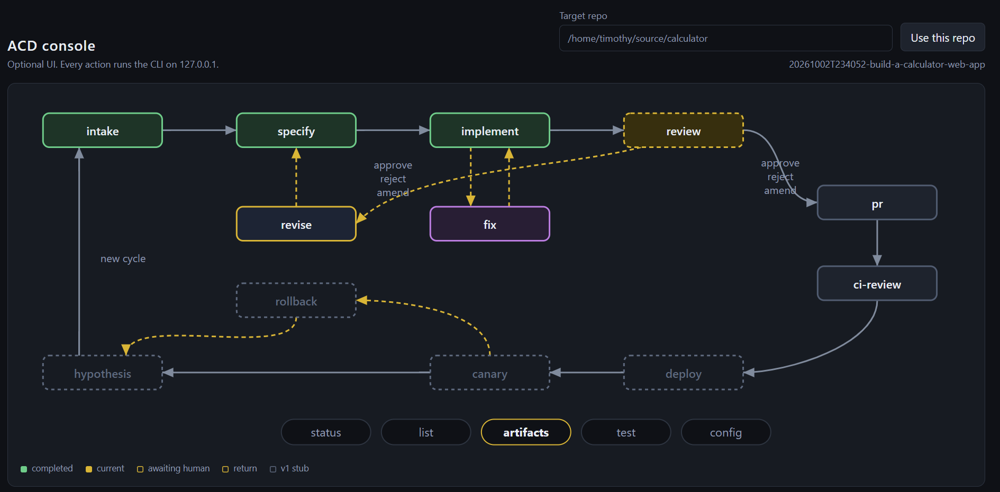

# acd-kit

**Agentic Continuous Delivery (ACD) for your repo, run with** `npx`**.**

ACD is a framework for building software following the practices of continuous integration, continuous delivery and TDD/BDD. You choose the agentic harness (eg. Cursor/Claude/etc) and run ACD steps via a CLI or UI.

The CLI is a **deterministic orchestrator**: typed stages, AI only for generative work, harness/HitL as configuration.

Based on [MinimumCD Agentic CD](https://beyond.minimumcd.org/docs/agentic-cd/).



## Why ACD

Agents are good at drafting and weak at staying inside a delivery process. Left alone, they choose the next step, rewrite the spec to match the code, and soften a test until it passes. ACD keeps that loop in the CLI. The model does the generative work. It does not decide what runs next.

You keep the harness you already use — Cursor, Claude, or the built-in stub. ACD owns the stages: a plain-English intake, a spec with a fixed order of authority, test-first implementation, and a review that returns structured findings. When review blocks, `revise` writes those findings back into the spec and `implement` reruns only the scenarios that need it. A red test suite allows only `fix`. Human approval is configuration, not a reminder you have to put in the prompt.

The picture above is that loop. Solid nodes are commands you can run today. Dashed nodes (`deploy`, `canary`, `rollback`, `hypothesis`) name the rest of the lifecycle; they are stubs in v1. Gold dashed arrows are the ways back: `revise` returns a review into the spec, `fix` restores a red pipeline, and a hypothesis that does not hold starts a new intake.

Authority, which an agent must not invert: intent, then user-facing behavior, then the feature description, then acceptance criteria, then system constraints, then implementation.

## Install: Empty folder → pipeline + UI

From a new directory (no `package.json` required):

example for new app starting in `~/source/calculator`

```bash
mkdir ~/source/calculator && cd ~/source/calculator
npx acd-kit init
npx acd-kit ui
```

That is the whole install. `init` writes **only** `.acd/` in your project. `ui` runs from the `acd-kit` package (including Next.js); you do not `npm install` anything in the app folder unless you want a local lockfile.

Then start a work item (in another terminal, or from the UI):

```bash
npx acd-kit intake --from "Build a calculator web app"
npx acd-kit specify
npx acd-kit implement
npx acd-kit review
```

That is the first loop. `specify` drafts the spec. `implement` builds one scenario at a time, test first. `review` checks the result. If review asks for changes, `npx acd-kit revise` folds them into the spec and you run `implement` again. `npx acd-kit approve review` is how a person accepts the review and moves on. In the UI, click a node to select the command, then Run. The same commands run either way.

Default harness is `stub` (no API keys). For Cursor agents, copy `.acd/.env.local.example` → `.acd/.env.local` and set `CURSOR_API_KEY`.

> Use `npx acd-kit`, not `npx acd`. The name `acd` on npm is a different package.

## Optional adapters (not in `.acd/`)

Cursor and GitHub only look at fixed repo-root paths, so these stay **opt-in**:

```bash
npx acd-kit init --cursor    # AGENTS.md + .cursor/rules and skills
npx acd-kit init --github    # .github/workflows/acd-ci-review.yml
```

Skills and agents used by the CLI stay **inside the** `acd-kit` **package**, not copied into your app.

## What `init` adds

| Path                           | Purpose                    | Commit? |
| ------------------------------ | -------------------------- | ------- |
| `.acd/acd.config.yaml`         | Thin project pins          | Yes     |
| `.acd/acd.config.local.yaml`   | Harness / URL overrides    | No      |
| `.acd/.env.local`              | API keys                   | No      |
| `.acd/system-constraints.yaml` | Copied into new work items | Yes     |
| `.acd/work/<id>/`              | Work sessions              | No      |

## Commands

Examples use `npx acd-kit`. `help`, `--help`, and `-h` print the short usage text.

These flags are optional on every command that loads project config (`config` through `hypothesis` below). `init`, `ui`, and `write-schemas` only honor the flags named in their rows.

| Flag | Effect |
| --- | --- |
| `--repo-root <path>` | Repository to operate on. Default: the current directory. |
| `--work-id <id>` | Work item under `.acd/work/`. Default: the latest one. `intake` always creates a new item. `list`, `test`, and `config` do not read it. |
| `--harness <name>` | Harness for this run (`stub`, `cursor`, or `anthropic`). |
| `--tier classify\|low\|med\|high` | Model tier for this run. |
| `--approve-policy all\|none` | Human approval on (`all`) or off (`none`) for this run. |
| `--require-approval` | Pause for a person where the stage supports it. |
| `--no-require-approval` | Skip that pause for this run. |

| Command | Description | Parameters | Example |
| --- | --- | --- | --- |
| `help` | Print usage. | None. Invoked as `help`, `--help`, or `-h`. | `npx acd-kit --help` |
| `init` | Create `.acd/` in a project. | `dir` optional path. Default: `--repo-root` or the current directory. `--cursor` optional; also write the Cursor adapter at the repo root. `--github` optional; also write the GitHub Actions workflow. `--repo-root <path>` optional. | `npx acd-kit init --cursor` |
| `ui` | Start the loopback console. Every button runs this same CLI. | `--port <n>` optional. Default: `4173`, or `ACD_UI_PORT`. `--repo-root <path>` optional. | `npx acd-kit ui --repo-root ~/source/calculator` |
| `write-schemas` | Regenerate `acd/schemas` from the kit types. For kit development. | None. | `npx acd-kit write-schemas` |
| `config` | Print the resolved harness, tier, model, and human-approval settings. | Shared flags. | `npx acd-kit config` |
| `intake` | Create a work item from plain English. | `--from <text>` required. Shared flags. | `npx acd-kit intake --from "Build a calculator web app"` |
| `specify` | Draft the spec. The classifier gates the validator. | `--artifact intent\|behavior\|feature\|acceptance\|all` optional. Default: `all`. Shared flags. | `npx acd-kit specify --artifact behavior` |
| `implement` | Implement scenarios test-first. With no scenario, runs the review follow-up queue when one is set, otherwise the remaining scenarios. Stops if the pipeline is red. | `--scenario <id>` optional. The id is the heading label (`3` or `E10a`). That scenario always calls the agent. Shared flags. | `npx acd-kit implement --scenario E10a` |
| `review` | Run mechanical hooks and the parallel review agents. A `block` decision exits 1. | Shared flags. | `npx acd-kit review` |
| `revise` | Fold the latest blocking review into the spec and queue `implement`. Leaves the review unapproved. Refuses while the pipeline is red. | Shared flags. | `npx acd-kit revise` |
| `pr` | Open a pull request whose body comes from the work-item artifacts. | Shared flags. | `npx acd-kit pr` |
| `ci-review` | Review the work item and run tests. With no work items, runs tests only. `ci_review` is the same command. | Shared flags. | `npx acd-kit ci-review` |
| `test` | Run the test command from config. A failure exits 1. | Shared flags. | `npx acd-kit test` |
| `fix` | Repair a red pipeline. This is the only command that may change code while the pipeline is red. | Shared flags. | `npx acd-kit fix` |
| `approve` | Accept a paused stage and record the approval. | `<stage>` required: `intake`, `specify`, `implement`, `review`, `pr`, `ci_review`, `fix`, `deploy`, `canary`, `rollback`, or `hypothesis`. Shared flags. | `npx acd-kit approve review` |
| `reject` | Clear a pause and record why. Re-run the stage afterward. | `<stage>` required (same names as `approve`). `--reason <text>` optional. Default: `rejected`. Shared flags. | `npx acd-kit reject specify --reason "Split the spec"` |
| `amend` | Keep the artifacts, save an optional guidance note, and clear the pause. | `<stage>` required (same names as `approve`). `--note <text>` optional. `--continue` optional; re-runs `specify` immediately. Other stages are re-run by hand. Shared flags. | `npx acd-kit amend specify --note "Keep the display to one line" --continue` |
| `status` | Print work-item state and the latest event. | `[work-id]` optional positional, or `--work-id`. Default: the latest work item. Shared flags. | `npx acd-kit status` |
| `list` | List work-item ids. | Shared flags. | `npx acd-kit list` |
| `artifacts` | List the files in a work item. | `[work-id]` optional positional, or `--work-id`. Default: the latest work item. Shared flags. | `npx acd-kit artifacts` |
| `reviews` | List review runs read from the event log, including findings. | `[work-id]` optional positional, or `--work-id`. Default: the latest work item. Shared flags. | `npx acd-kit reviews` |
| `events` | Print `events.jsonl` in session order, one decision per event. | `[work-id]` optional positional, or `--work-id`. Default: the latest work item. Shared flags. | `npx acd-kit events` |
| `artifact-save` | Write one file under the work item. | `<name>` required, such as `intent.md`. `state.json`, `events.jsonl`, and `telemetry.jsonl` are reserved. `--contents <text>` optional when the body is piped on stdin; one of the two is required. `--work-id <id>` optional, or pass the id as a second argument. Other shared flags. | `npx acd-kit artifact-save feature.md --contents "## Musts"` |
| `deploy` | Named lifecycle step. v1 exits with an error; the stage is not implemented. | Shared flags are accepted. | `npx acd-kit deploy` |
| `canary` | Named lifecycle step. v1 exits with an error; the stage is not implemented. | Shared flags are accepted. | `npx acd-kit canary` |
| `rollback` | Named lifecycle step. v1 exits with an error; the stage is not implemented. | Shared flags are accepted. | `npx acd-kit rollback` |
| `hypothesis` | Named lifecycle step. v1 exits with an error; the stage is not implemented. | Shared flags are accepted. | `npx acd-kit hypothesis` |

The UI listens on [http://127.0.0.1:4173](http://127.0.0.1:4173) (loopback only) and drives this CLI.

## Configuration

Later layers win:

1. Kit defaults (`acd/config/acd.config.default.yaml` inside `acd-kit`)
2. `.acd/acd.config.yaml`
3. `.acd/acd.config.local.yaml`
4. `.acd/.env.local`

## OpenTelemetry

Each `acd` command, pipeline stage, and harness (LLM) call emits an [OpenTelemetry](https://opentelemetry.io/) **trace span**. A separate collector or backend can use those spans to chart time and cost across ACD and to see the main decision each step made.

Telemetry is **off** for external collectors until you set an OTLP endpoint. The ACD UI always records spans for the command it is running (no collector required) and shows them live in the Telemetry panel.

The CLI process flushes spans on exit, so short commands still export to OTLP when configured.

### What each span reports

| Attribute                                                            | Meaning                                                                                                                       |
| -------------------------------------------------------------------- | ----------------------------------------------------------------------------------------------------------------------------- |
| `acd.duration_ms`                                                    | Wall time for that command, stage, or harness call                                                                            |
| `acd.cost_usd`                                                       | Dollar cost of generative work in that span                                                                                   |
| `acd.cost_source`                                                    | `api` if the harness returned a dollar amount; `estimated` from token usage × pricing table; `unavailable` for stub / unknown |
| `acd.decision`                                                       | Deterministic headline from structured output (not an LLM paraphrase)                                                         |
| `acd.output`                                                         | JSON of the stage/command contract (sanitized: no file bodies or spec document text)                                          |
| `acd.pipeline_status` / `acd.scenario_count` / `acd.review_decision` | Queryable fields promoted from that JSON                                                                                      |
| `acd.input_tokens` / `acd.output_tokens`                             | Usage from the Anthropic Messages `usage` field, Cursor SDK `usage` when present, or a character-length estimate              |
| `acd.command` / `acd.stage` / `acd.work_id`                          | Which ACD step and work item                                                                                                  |

Parent/child layout: `acd.command.<name>` → `acd.stage.<name>` → `acd.harness.<role>`.

Cost for Anthropic comes from the same Messages API response (`usage.input_tokens` / `usage.output_tokens`) converted with `telemetry.pricing`. Cursor passes through usage when the SDK includes it; otherwise ACD estimates tokens from prompt/response size. Override rates in YAML for your contracts. Stub harness cost is `$0`.

### Connect a consumer

ACD speaks **OTLP/HTTP traces** (the OpenTelemetry standard export). Any backend that accepts OTLP will work: Jaeger, Grafana Alloy/Tempo, Honeycomb, Datadog, New Relic, an OpenTelemetry Collector, and so on.

**1. Run a collector** (Jaeger all-in-one is enough locally):

```bash
docker run --rm -p 16686:16686 -p 4318:4318 jaegertracing/all-in-one:latest
```

Jaeger UI: [http://127.0.0.1:16686](http://127.0.0.1:16686). OTLP HTTP is on port `4318`.

**2. Point ACD at it** — env vars in `.acd/.env.local` (or your shell) win:

```bash
OTEL_EXPORTER_OTLP_ENDPOINT=http://127.0.0.1:4318
OTEL_SERVICE_NAME=acd-kit
```

Or in `.acd/acd.config.local.yaml`:

```yaml
telemetry:
  enabled: true
  otlpEndpoint: http://127.0.0.1:4318
```

**3. Run a pipeline step** (`npx acd-kit specify`, or the same command from the UI). Search the collector for service `acd-kit`. The UI Telemetry panel shows the same spans as they complete: duration, cost, decision, and expandable structured output.

Hosted backends usually want a header. Example Honeycomb:

```bash
OTEL_EXPORTER_OTLP_ENDPOINT=https://api.honeycomb.io
OTEL_EXPORTER_OTLP_HEADERS=x-honeycomb-team=YOUR_API_KEY
```

Print spans to stderr without a collector: `ACD_OTEL_CONSOLE=1`. Disable everything: `OTEL_SDK_DISABLED=true`.

Standard OpenTelemetry env vars (`OTEL_EXPORTER_OTLP_ENDPOINT`, `OTEL_EXPORTER_OTLP_TRACES_ENDPOINT`, `OTEL_EXPORTER_OTLP_HEADERS`, `OTEL_SERVICE_NAME`) are documented at [opentelemetry.io](https://opentelemetry.io/).

## Developing the kit

```bash
git clone https://github.com/timothywisdom/agentic-continuous-delivery
cd agentic-continuous-delivery
npm install
npx acd-kit --help
```
